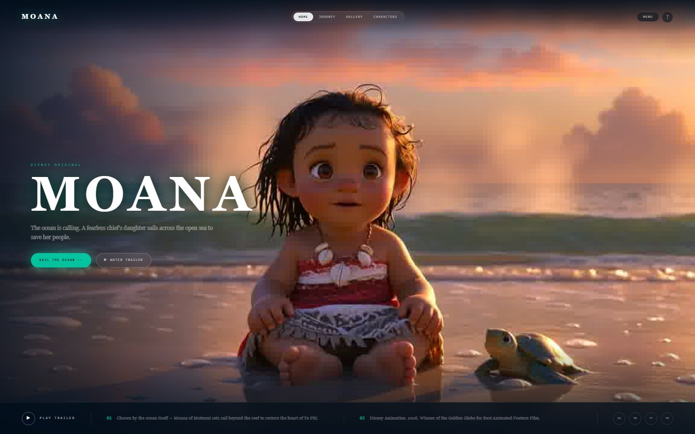
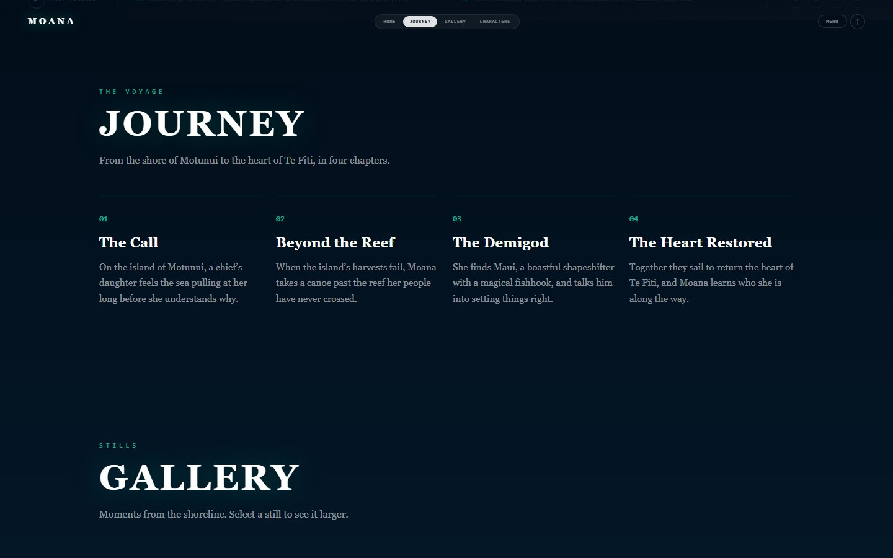
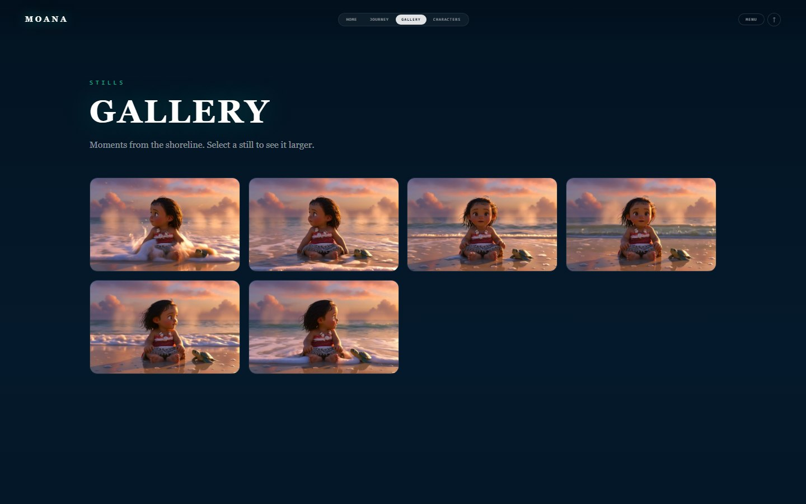
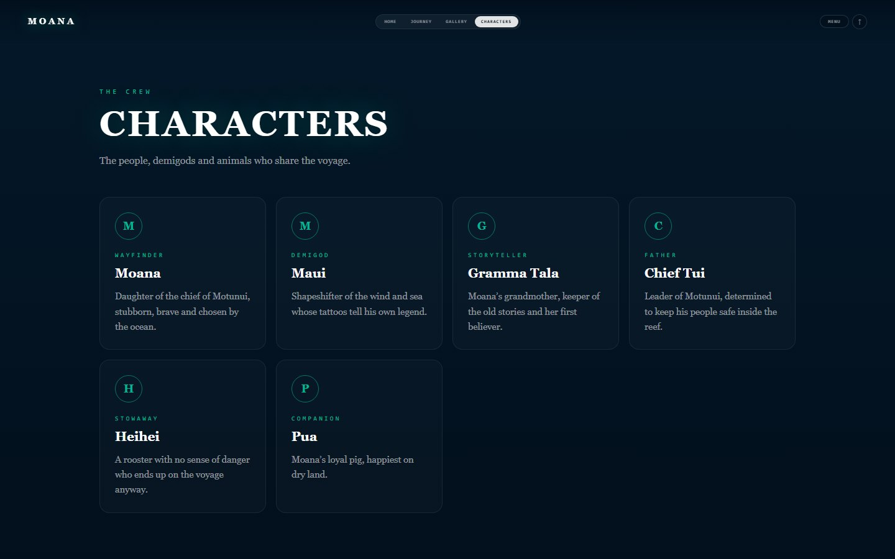
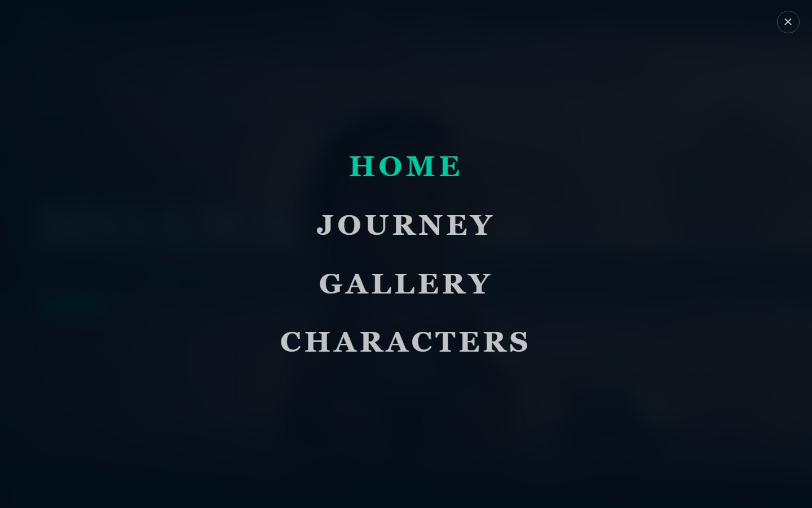
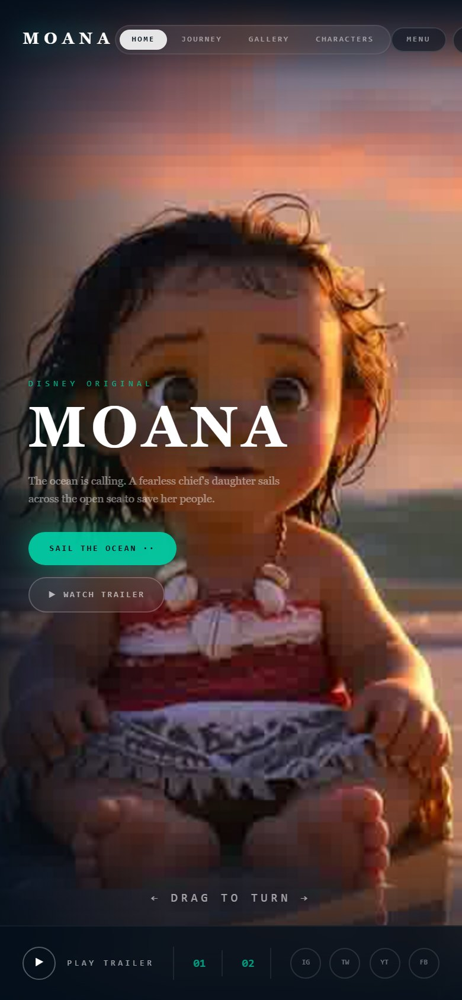

<div align="center">

<a href="https://moana-graphic-editing.vercel.app">
  
</a>

### 🌊 Live site: **[moana-graphic-editing.vercel.app](https://moana-graphic-editing.vercel.app)**


</div>

An interactive, fan-made Moana landing page. The hero is a 3D-rendered character that turns to
follow your mouse, or your finger on a phone, followed by Journey, Gallery and Characters sections
and the official trailer.

> **Fan-made practice project.** Not affiliated with or endorsed by Disney. Moana and all related
> characters belong to Disney.

## The 3D hero

<div align="center">
  <a href="https://moana-graphic-editing.vercel.app">
    
  </a>
  <br>
  <sub>The same frames the site uses, played back and forth. On the live site <b>you</b> control the turn.</sub>
</div>

## Screenshots

| Hero | Journey |
| :---: | :---: |
|  |  |
| **Gallery** | **Characters** |
|  |  |
| **Menu overlay** | **Phone** |
|  |  |

## Features

- **Turnable 3D hero** — move the mouse across the page, or drag left and right on a touch screen.
- **Fast first paint** — the middle frame loads first, the rest stream in around it.
- **Lighter on phones** — phones and slow or data-saving connections fetch half the frames.
- **Scrolling sections** — Journey, Gallery (with a lightbox) and Characters, revealed as you scroll.
- **Working navigation** — fixed nav that highlights the section in view, a full-screen menu and a back-to-top button.
- **Official trailer** — plays in an overlay, embedded from YouTube.
- **Share cards** — Open Graph and Twitter metadata so links to the site show a preview.

## How it works

### 1. The "3D" is a frame sequence

There is no 3D engine in the browser. The character was rendered ahead of time as **181 still
frames** of one head turn (`public/moana/ezgif-frame-001.jpg` to `-181.jpg`). The page shows one
frame at a time on a full-screen `<canvas>`, and which frame it shows depends on where your pointer is.

```
pointer far left ───────────── middle ───────────── pointer far right
   frame 1                    frame 91                   frame 181
```

### 2. Pointer position picks the frame

- **Mouse:** the horizontal position across the hero maps straight to a frame number.
- **Touch:** a horizontal drag scrubs the frames *relative to where the drag started*, so the
  character never jumps. One swipe across the screen covers the whole turn. Vertical drags are
  ignored so the page still scrolls.

Each frame is drawn with "cover" scaling, so it fills the screen at any size without stretching.

### 3. Frames load in a smart order

Requesting 181 images at once would leave the hero blank for a while. Instead:

1. The **middle frame** (facing the viewer) loads first, on its own, and is drawn straight away.
2. The rest load outwards from the middle, **six at a time**.
3. If you move to a frame that has not arrived yet, the **nearest loaded frame** is drawn.
4. Phones and slow or data-saving connections fetch **every second frame** (91 instead of 181).

### 4. The rest of the page

| Part | How it works |
| --- | --- |
| Entrance animation | A GSAP timeline fades in the nav, the title block and the bottom bar. |
| Active nav item | An `IntersectionObserver` watches which section crosses the middle of the screen. |
| Scroll reveal | A second `IntersectionObserver` adds a class that fades each block in once. |
| Gallery lightbox | Clicking a still opens it large; Escape or a click closes it. |
| Trailer | An overlay with a `youtube-nocookie.com` embed of the official trailer, plus a plain YouTube link as a fallback. |
| Reduced motion | Smooth scrolling and reveal animations are switched off for people who ask for less motion. |

## How it's built

| Layer | Choice |
| --- | --- |
| Framework | [Next.js 16](https://nextjs.org) (App Router, Turbopack), statically prerendered |
| UI | [React 19](https://react.dev) with TypeScript |
| Styling | Inline styles for components, [Tailwind CSS 4](https://tailwindcss.com) and a small `globals.css` |
| Animation | [GSAP 3](https://gsap.com) for the entrance, the Canvas 2D API for the hero |
| Hosting | [Vercel](https://vercel.com), deployed automatically on every push to `master` |

### Project structure

```
app/
  layout.tsx            Page shell, title and share metadata
  page.tsx              Hero + Sections
  globals.css           Base styles, scroll reveal, hover effects
  components/
    Hero.tsx            Canvas frame player, nav, menu, trailer overlay
    Sections.tsx        Journey, Gallery (lightbox), Characters, footer
public/
  moana/                The 181 hero frames
docs/
  assets/               README banner and hero animation
  screenshots/          README screenshots
```

### Run it locally

```bash
git clone https://github.com/Guru1315/Moana-graphic-editing.git
cd Moana-graphic-editing
npm install
npm run dev
```

Then open [http://localhost:3000](http://localhost:3000).

| Command | What it does |
| --- | --- |
| `npm run dev` | Start the development server |
| `npm run build` | Create a production build |
| `npm run start` | Serve the production build |
| `npm run lint` | Run ESLint |

### Deployment

The repository is linked to a Vercel project. Every push to `master` builds and publishes to
[moana-graphic-editing.vercel.app](https://moana-graphic-editing.vercel.app); other branches get
preview deployments.

## Credits

- Moana, its characters and the embedded trailer are the property of Disney.
- Built on an initial hero by [alagappan567](https://github.com/alagappan567/moana).
